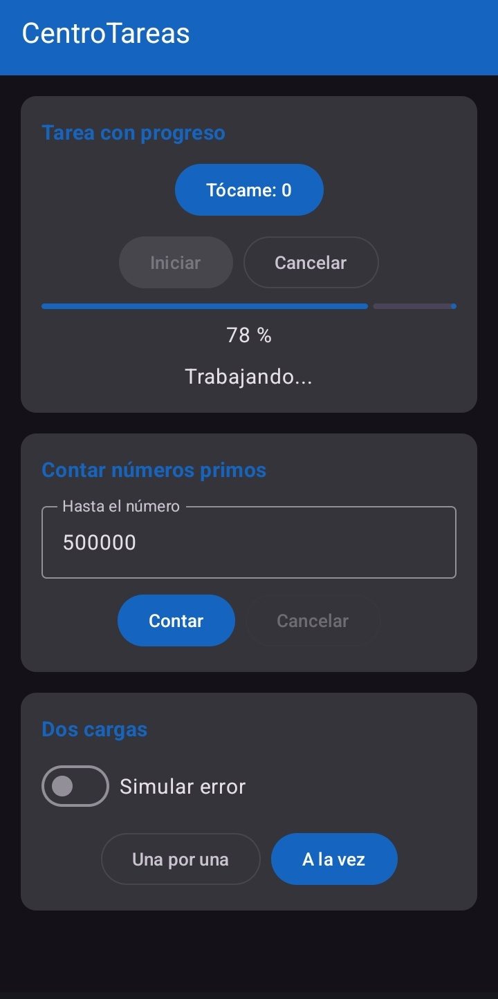
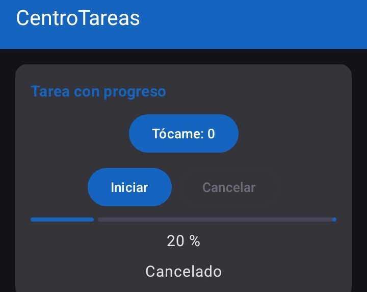
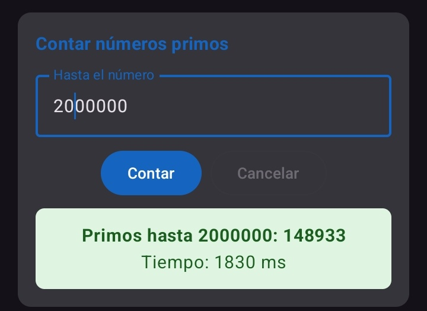
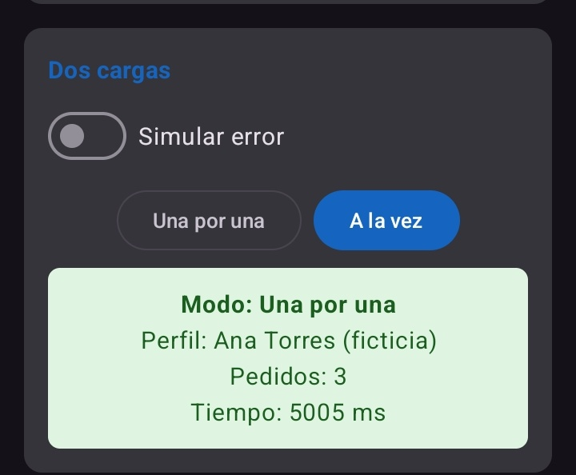
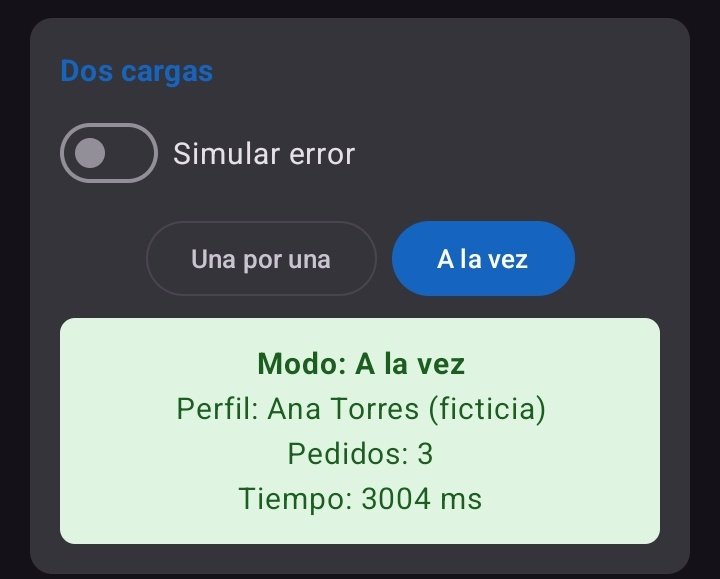
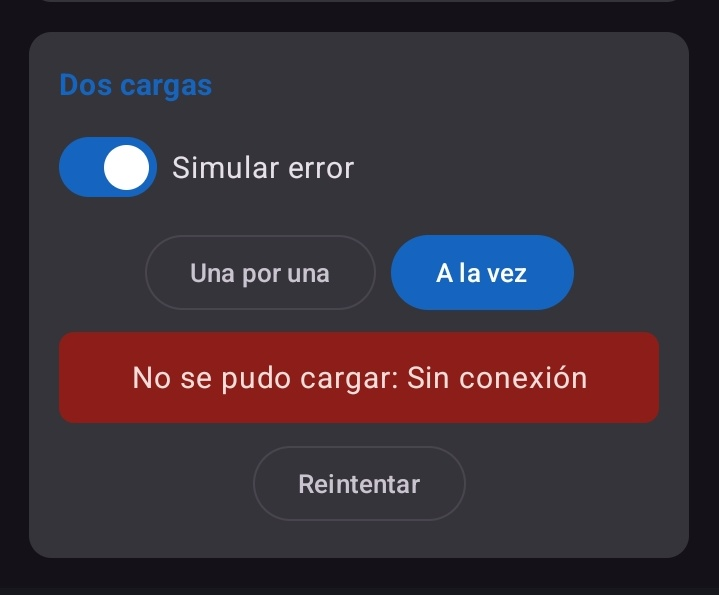

# CentroTareas · Laboratorio 14

App para practicar hilos y corrutinas: hace tres trabajos que tardan sin que la pantalla se congele.

- **Alumno:** Carlos Junco
- **Curso:** Programación en Móviles (Hilos en Android)
- **Docente:** Juan León S.
- **Hecho con:** Kotlin, Jetpack Compose, Material 3, corrutinas y ViewModel con StateFlow

## ¿Qué hace la app?

| Tarjeta | Qué hace | Botones |
|---|---|---|
| **Tarea con progreso** | Simula un trabajo de unos 4 s con una barra de 0 a 100 % | Iniciar / Cancelar |
| **Contar números primos** | Cuenta los primos desde 2 hasta el número escrito (cálculo pesado) | Contar / Cancelar |
| **Dos cargas** | Carga un perfil (2 s) y 3 pedidos (3 s) ficticios, una por una o a la vez | Una por una / A la vez / Reintentar |

Arriba de todo está el botón **Tócame**, que suma toques. Lo uso como "prueba de vida": si sigue sumando mientras una tarea corre, la pantalla está libre. En la tarjeta de cargas hay un interruptor **Simular error** para que los pedidos fallen con `IOException("Sin conexión")`.

## Organización del código

```
com.junco.centrotareas
│
├── MainActivity.kt .................. crea el TareasViewModel con su Factory
├── model/Estados.kt ................. estados de pantalla: PrimosUi y CargaUi
├── data/
│   ├── TareasRepository.kt .......... contrato: contarPrimos, cargarPerfil, cargarPedidos
│   └── TareasRepositoryLocal.kt ..... cargas con delay y conteo de primos en Dispatchers.Default
├── viewmodel/
│   ├── TareasViewModel.kt ........... lanza las corrutinas y publica los estados en StateFlow
│   └── TareasViewModelFactory.kt .... le entrega el Repository al ViewModel
└── ui/
    ├── PantallaTareas.kt ............ Tócame, las tres tarjetas y los recuadros de resultado
    └── theme/ ....................... colores y tipografía
```

## Capas (MVVM + Repository)

```
 ┌──────────────────────────┐
 │  PantallaTareas (View)   │  solo dibuja el estado y avisa los clics
 └────────────┬─────────────┘
      eventos │  ▲ collectAsState()
              ▼  │
 ┌──────────────────────────┐
 │     TareasViewModel      │  viewModelScope.launch, Job, StateFlow
 └────────────┬─────────────┘
              │ llama a la interfaz
              ▼
 ┌──────────────────────────┐      ┌─────────────────────────┐
 │  TareasRepository        │ ───▶ │  TareasRepositoryLocal  │
 └──────────────────────────┘      └─────────────────────────┘
```

- La pantalla no lanza corrutinas ni usa `Thread`: solo llama funciones del ViewModel.
- El ViewModel no recibe `Context` ni conoce Composables. Todas sus corrutinas van en `viewModelScope`.
- El Repository no sabe nada de la pantalla. Sus funciones `suspend` no bloquean: las cargas usan `delay` y los primos se calculan en `Dispatchers.Default`.
- En el código final no quedan `GlobalScope`, `runBlocking` ni `Thread.sleep` (lo revisé con `git grep`).

## Observación del Paso 1

Pulsé **Tarea larga (MAL)** y enseguida **Tócame** varias veces: durante unos 4 segundos la app no hizo nada. El contador no subió, los botones no reaccionaron y al final apareció **Terminó**, sin que se viera nunca **Trabajando...**.

- **¿Qué le pasa a la pantalla?** Se queda congelada, porque `Thread.sleep(4000)` duerme el **hilo principal (main)**, que es el que dibuja la interfaz y recibe los toques.
- **¿Por qué no aparece "Trabajando..."?** El valor del mensaje sí cambia, pero la pantalla se redibuja recién cuando el hilo principal queda libre. Como se durmió justo después, cuando se despierta el mensaje ya es "Terminó" y solo se dibuja ese.
- **¿Y con 10 segundos?** Saldría el aviso **ANR ("CentroTareas no responde")**, con la opción de cerrar la app o esperar. Android lo muestra cuando el hilo principal pasa unos 5 segundos sin responder a un toque.

**Cómo lo arreglé (Paso 2):** la espera pasó a `viewModelScope.launch { withContext(Dispatchers.Default) { delay(4000) } }`. En Logcat, con el filtro `HILO`, aparece `Antes: main`, luego `Dentro: DefaultDispatcher-worker-…` y al final `Despues: main`.

## Capturas

| Tarea con progreso | Tarea cancelada | Primos |
|---|---|---|
|  |  |  |

| Una por una (≈ 5000 ms) | A la vez (≈ 3000 ms) | Error simulado |
|---|---|---|
|  |  |  |

## Para pensar

**1. ¿Por qué no se veía "Trabajando..." en el Paso 1?**

Porque el hilo principal hace dos trabajos: ejecutar mi código y dibujar la pantalla. Con `Thread.sleep(4000)` lo tuve ocupado durmiendo, así que no pudo dibujar el cambio a "Trabajando...". Cuando quedó libre, el mensaje ya decía "Terminó".

**2. ¿Qué diferencia hay entre `Thread.sleep` y `delay`?**

| `Thread.sleep(ms)` | `delay(ms)` |
|---|---|
| Bloquea el hilo entero | Suspende solo la corrutina; el hilo queda libre |
| En el hilo principal congela la pantalla | La pantalla sigue respondiendo |
| No se puede cancelar | Se cancela al cancelar la corrutina (revisa la cancelación) |
| Se puede llamar en cualquier lado | Solo dentro de una corrutina o función `suspend` |

**3. ¿Por qué `Dispatchers.Default` para los primos y `Dispatchers.IO` para la red?**

Contar primos mantiene ocupado el **procesador** todo el tiempo, y `Default` tiene un hilo por núcleo, justo lo necesario para repartir ese cálculo. En una petición de **red** el hilo pasa casi todo el tiempo **esperando** la respuesta; `IO` tiene muchos más hilos para que varias esperas a la vez no ocupen los hilos de cálculo. En este lab las cargas son `delay`, que no bloquea ningún hilo, así que no hizo falta cambiarlas de dispatcher.

**4. ¿Qué pasaría con la corrutina si el usuario cierra la pantalla? ¿Qué papel cumple `viewModelScope`?**

Si el usuario sale de la pantalla, el ViewModel se destruye y `viewModelScope` **cancela todas sus corrutinas**. No queda nada trabajando para una pantalla que ya no existe. En cambio, al **rotar** el celular la Activity se recrea pero el ViewModel no, por eso la barra sigue desde donde iba y no vuelve a 0.

**5. ¿Por qué `async` tarda 3 s y no 5 s? ¿Qué pasa si una de las dos cargas falla?**

Con `async` las dos cargas arrancan juntas. El perfil termina a los 2 s y los pedidos a los 3 s, así que el total es lo que tarda la más lenta (≈ 3 s). Una por una se suman: 2 + 3 ≈ 5 s. Si una falla, `coroutineScope` cancela la otra y la excepción sube hasta mi `try/catch`. Ahí primero dejo pasar la `CancellationException` y luego muestro el recuadro rojo con **Reintentar**, sin mostrar un resultado a medias.
